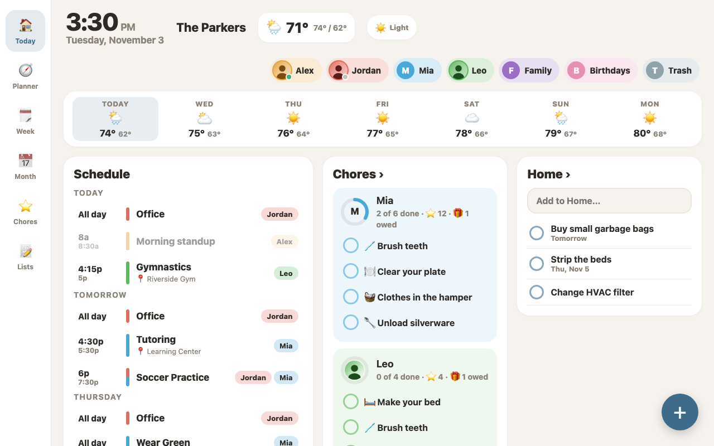
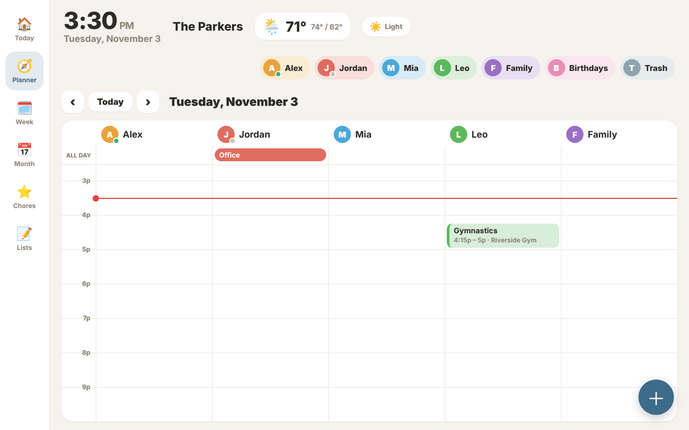
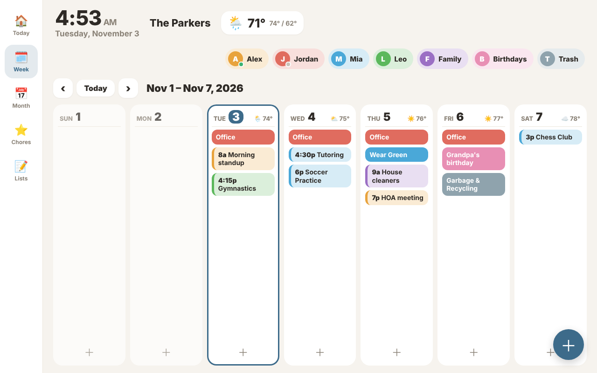
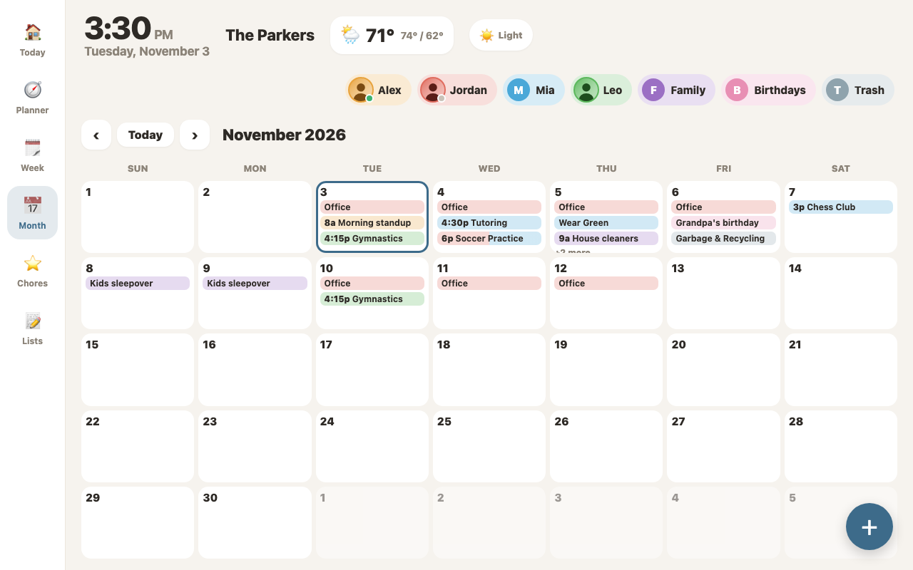
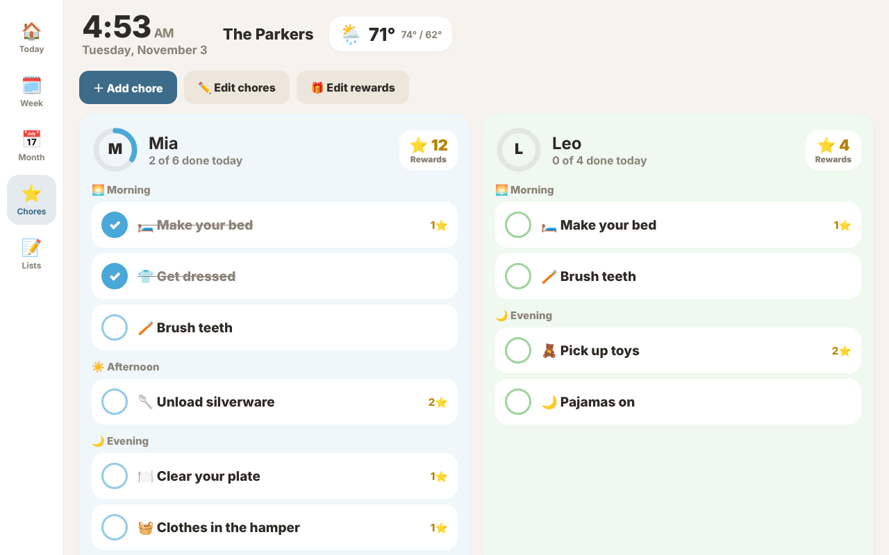
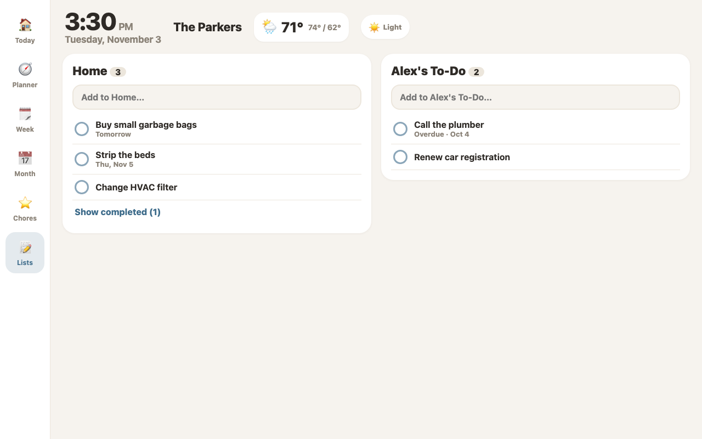
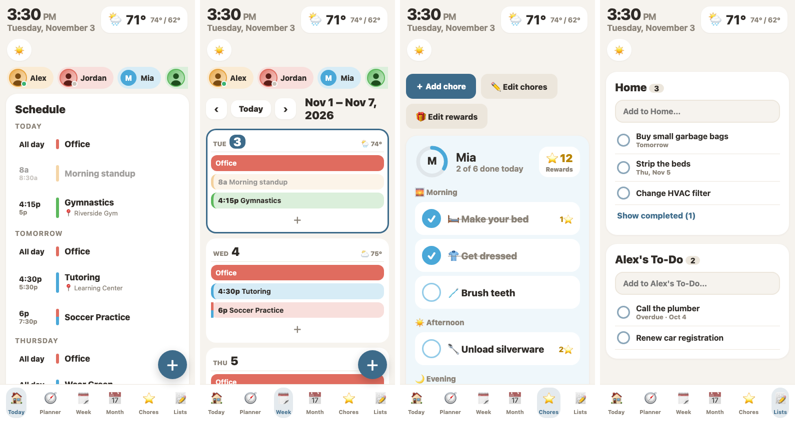
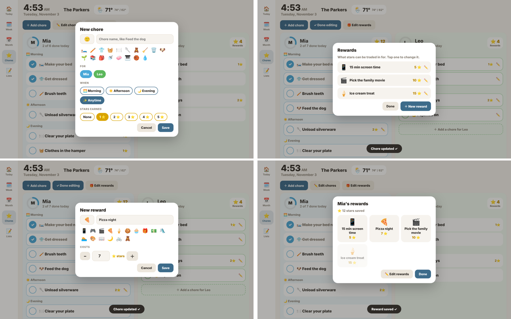
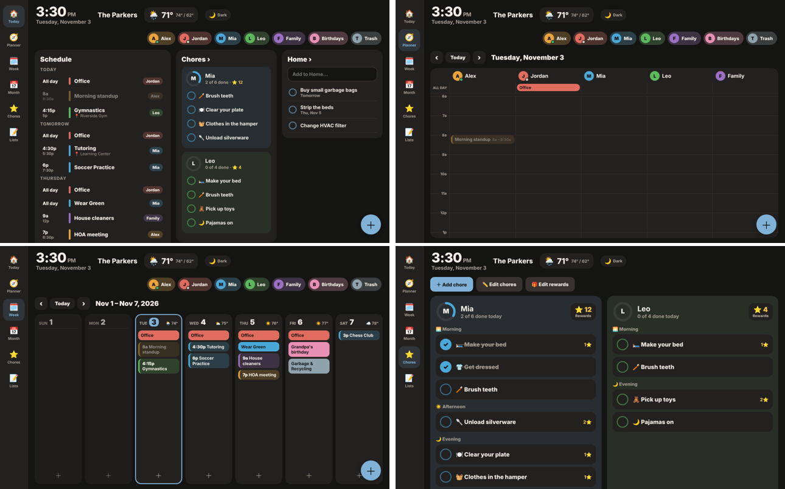

# SkyFam Card

A Skylight-style family hub for Home Assistant, built as one custom Lovelace card. It shows the family calendar, kids' chores with stars and rewards, and shared to-do lists, and it works on a wall tablet and a phone from the same dashboard.

It uses only native Home Assistant entities, so everything also works with voice, automations and the HA mobile app:

| What | Entity |
|---|---|
| Calendars | any `calendar.*` (Google, CalDAV, Local Calendar...) |
| Lists | any `todo.*` (Todoist, Local To-do, Shopping List...) |
| Chores | one `todo.*` list per kid (Local To-do recommended) |
| Stars | one `counter.*` per kid |
| Rewards | one `todo.*` list (optional) |
| Weather | any `weather.*` |
| Home / away dots | `person.*` |



## Views

- **Today**: schedule for today and the next two days, each kid's chore progress, and your first list.
- **Planner**: today as an hourly timeline with a column for each person (plus one for shared calendars), an all-day row, and a red line at the current time. Tap an empty slot to add an event for that person at that hour. Opens scrolled to now.
- **Week** and **Month**: events colored by person. Tap a person chip to hide or show their events. Tap an event for details, or **＋** to add one.
- **Chores**: big tap targets grouped by Morning / Afternoon / Evening / Anytime, stars per chore, a progress ring, and confetti when a kid finishes everything. Add, edit and delete chores from the card.
- **Lists**: every configured to-do list side by side, with add, check off, and show completed.
- **Rewards**: kids tap their star badge to trade stars for rewards. Rewards are edited from the card. **⭐ Adjust stars** on that screen lets a parent add or take a star, or set an exact total (behind the parent PIN when one is set).
- **Owed rewards**: every redeemed reward goes on an Owed list on the Chores tab until a parent taps **Given**. **↩** cancels it and gives the stars back. The kid's rewards screen shows what they're waiting on.
- **Photos**: a person's Home Assistant photo replaces their initials on chips, Planner columns and chore rings.

On screens under 760px wide the side rail becomes a bottom tab bar and the views stack.

**Dark mode**: the button next to the weather cycles Light → Dark → Auto (follows Home Assistant's theme) → Sunset (dark while `sun.sun` is below the horizon). The choice is saved per device, so a kiosk can use Sunset while phones stay on Auto.



| Week | Month |
|---|---|
|  |  |

| Chores | Lists |
|---|---|
|  |  |







## Install

### HACS (custom repository)

1. HACS → ⋮ → **Custom repositories** → add this repo's URL, category **Dashboard**.
2. Download **SkyFam Card**, then hard refresh the browser.

### Manual

1. Copy `dist/skyfam-card.js` to `/config/www/skyfam-card.js`.
2. Settings → Dashboards → ⋮ → **Resources** → add `/local/skyfam-card.js?v=0.3.0` as a **JavaScript module**. Bump the `?v=` when you update the file.

## Setup

1. **Chore lists**: Settings → Devices & services → Add integration → **Local To-do**. Create one list per kid (for example "Mia's Chore Chart").
2. **Stars**: Settings → Devices & services → Helpers → Create helper → **Counter**, one per kid, minimum 0.
3. **Rewards** (optional): one more Local To-do list, for example "SkyFam Rewards", and a second one, for example "SkyFam Rewards Owed", to track redeemed rewards until they're given.
4. **Nightly reset**: add the automation in [`examples/reset-chores-automation.yaml`](examples/reset-chores-automation.yaml) so chores reopen every night. Earned stars stay.
5. Add a dashboard with a single **Panel** view, then add the **SkyFam family hub** card from the card picker. It starts pre-filled with the people, calendars and weather Home Assistant already has.

### Visual editor

Everything below can be set from the card's **Edit** screen instead of YAML:

- **General**: title, weather, which view to start on, default theme, first day of the week, idle timeout.
- **People**: one row per person with a color picker, calendars, the calendar new events go to, home/away person, chore list, star counter and the "[Name] - Event" title option. Reorder with the arrows; the remove button asks once before deleting.
- **Shared calendars**: family, birthdays, trash day and so on, with a read-only switch.
- **Lists**, **Chores and rewards** (rewards list, parent PIN), **Planner** hours and **Advanced** layout.

The preview updates as you type. Defaults are left out of the saved YAML so it stays short.

## Configuration

```yaml
type: custom:skyfam-card
title: The Parkers
weather_entity: weather.forecast_home
idle_return_minutes: 3      # kiosk: go back to Today after 3 idle minutes (0 = off)
first_day: 0                # 0 = Sunday, 1 = Monday
# parent_pin: "1234"        # optional: PIN pad before editing chores or rewards
people:
  - name: Alex
    color: "#f6bf26"
    calendars: [calendar.alex]
    person: person.alex     # optional: green dot when home
  - name: Jordan
    color: "#e67c73"
    calendars: [calendar.jordan]
    person: person.jordan
  - name: Mia
    color: "#4fc3f7"
    calendars: [calendar.mia]
    chores: todo.mia_chore_chart
    stars: counter.mia_stars
    prefix_titles: true     # new events get "[Mia] - " in front of the title
  - name: Leo
    color: "#66bb6a"
    calendars: [calendar.leo]
    chores: todo.leo_chore_chart
    stars: counter.leo_stars
    prefix_titles: true
shared:
  - name: Family
    color: "#ab47bc"
    entity: calendar.family
  - name: Birthdays
    color: "#f48fb1"
    entity: calendar.birthdays
    read_only: true         # not offered when adding events
lists:
  - entity: todo.home
    name: Home
    today: true             # stack on the Today screen
  - entity: todo.shopping_list
    name: Groceries
    today: true
rewards_list: todo.skyfam_rewards
rewards_owed_list: todo.skyfam_rewards_owed
```

### Options

| Option | Default | Description |
|---|---|---|
| `people` | required | Family members. Each takes `name`, `color`, `calendars`, and optionally `person` (photo and home/away dot), `picture` (image URL, overrides the person's photo), `chores`, `stars`, `prefix_titles`, `initials`, `add_calendar` (which calendar new events go to; defaults to the first). |
| `shared` | `[]` | Shared calendars, as `entity`, `name`, `color`, `read_only`. |
| `lists` | `[]` | To-do lists, as `entity`, `name` and `today`. Lists with `today: true` stack on the Today screen in order; with none set, the first list shows there. |
| `today_list_items` | `5` | When more than one list is on Today, items shown per list before a "+ N more" link. |
| `rewards_list` | none | A to-do list holding the rewards. Without it, `rewards:` from the config is used and can't be edited from the card. |
| `rewards_owed_list` | none | A to-do list where redeemed rewards wait until a parent marks them given. Each item's description reads "Mia · 10⭐ · redeemed Nov 3". |
| `hide_pictures` | `false` | Show initials instead of photos. |
| `rewards` | `[]` | Static rewards, as `name`, `cost`, `icon`. Only used when `rewards_list` is not set. |
| `weather_entity` | none | Current temperature, today's high/low, and a forecast in each week column. |
| `title` | none | Shown next to the clock on wide screens. |
| `default_view` | `today` | `today`, `planner`, `week`, `month`, `chores` or `lists`. |
| `planner_start_hour` | `6` | First hour shown in Planner. |
| `planner_end_hour` | `22` | Last hour shown in Planner. |
| `planner_hour_height` | `64` | Pixels per hour in Planner. |
| `planner_shared_name` | first shared calendar's name | Title of the Planner column for shared calendars. |
| `idle_return_minutes` | `3` | Return to the default view after this many idle minutes. `0` turns it off. |
| `first_day` | `0` | First day of the week. |
| `parent_pin` | none | Asks for this PIN before editing chores or rewards. Unlocks for 5 minutes. A soft lock for kids, not real security: anyone who can edit the dashboard can read it. |
| `theme` | `light` | Starting theme: `light`, `dark`, `auto` (follows Home Assistant) or `sun` (dark after sunset). The header button overrides it per device. |
| `height_offset` | auto | Pixels to subtract from the screen height. The card measures this itself; set it only if it sizes wrong. |

### How chores and rewards are stored

Chores are plain to-do items, so they can also be added from the HA to-do screen or by voice. The card reads two things from each chore's **description**:

- a time of day: `morning`, `afternoon`, `evening` (or `night`), or `anytime` (the default)
- a star value written as `2⭐`
- optional days: `mon,thu`, `weekdays`, `weekends` or full names like `saturday`. On other days the chore is hidden (edit mode still shows it, dimmed). No days means every day.

So `🛏️ Make your bed` with the description `morning 1⭐` shows under Morning and is worth 1 star. `🗑️ Trash out` with `evening 3⭐ tue,fri` shows only on Tuesdays and Fridays.

Stars are added and taken with `counter.increment` / `counter.decrement`, one step per star, so two screens changing stars at once can't overwrite each other. Leave the counter's step at 1. A leading emoji in the name is shown as the chore's icon.

Rewards work the same way: the item name is the reward (with an optional leading emoji) and the description is its cost, for example `10⭐`.

Calendar events titled `[Name] - Event` are shown in that person's color with the prefix removed, whichever calendar they are on.

## Development

The card is one file with no build step: `dist/skyfam-card.js`.

`test/harness.html` renders the card. `test/editor.html` shows the visual editor beside a live preview, with a small stand-in for Home Assistant's `ha-form`.

The harness renders the card with a mock `hass` object and sample data. To take screenshots with Playwright:

```sh
cd test
node shoot.js shots 1280 800          # every view at tablet size
FAKE_TIME=2026-11-03T15:30:00 DARK=1 node shoot.js shots-dark 1280 800   # pinned clock, dark mode
node shoot.js shots-phone 390 844     # phone size
node edit-test.js shots-edit          # clicks through adding/editing chores and rewards
node editor-test.js shots-editor      # drives the visual editor and checks the YAML it saves
node owed-test.js shots-owed          # photos, redeeming a reward, marking it given, refunding
node today-lists-test.js shots-tl     # several lists stacked on Today
node days-stars-test.js shots-ds      # day-based chores, star changes via counter increment/decrement
node stars-adjust-test.js shots-sa    # parent star adjuster: PIN, +1/-1, set an exact total
```

Calendar events are read through `GET /api/calendars/<entity>`; to-do lists and the forecast through websocket subscriptions (`todo/item/subscribe`, `weather/subscribe_forecast`).
